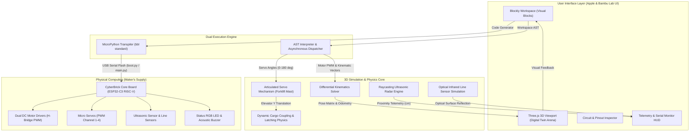

# Brick Studio

### Independent Open-Source K-12 Robotics, 3D Simulation & Physical Computing Platform
#### A Community Initiative & Ecosystem Proposal for Bambu Lab Maker's Supply & MakerWorld

---

[Live Demo](https://brick-studio.local) | [Open Proposal to Bambu Lab](docs/BAMBU_LAB_PROPOSAL.md) | [Curriculum Guide](docs/curriculum/INDEX.md) | [Hardware BOM](docs/HARDWARE_BOM.md) | [Contributing](CONTRIBUTING.md)

---

> **Notice:** Brick Studio is an independent open-source community initiative developed by educators and robotics engineers. It is not an official product of, nor is it formally affiliated with or endorsed by Bambu Lab (Shenzhen Tuozhu Technology Co., Ltd.). Bambu Lab, MakerWorld, Bambu Studio, and Maker's Supply are trademarks of Bambu Lab.

---

## An Open Invitation to the Bambu Lab Team

Dear Bambu Lab Team (Dr. Tao, MakerWorld Product Group, Maker's Supply Team, and Community Leadership),

We built **Brick Studio** because we believe Bambu Lab has created the most transformative 3D printing ecosystem in history. With high-speed reliable hardware (X1, P1, A1 series), the thriving MakerWorld community, and the Maker's Supply component catalog, you have established the physical foundation for the future of making.

However, in the global educational robotics market ($4.2B), millions of classrooms, teachers, and students remain locked into expensive, closed, non-printable systems like **LEGO Education Spike Prime** ($450+) and **VEX IQ**.

While Maker's Supply provides the core electronics (ESP32-C3 CyberBrick board, N20 motors, servos, sensors), **there is currently no official zero-install visual programming platform or 3D digital twin software connecting these components together.**

We engineered **Brick Studio** to prove that open physical computing combined with additive manufacturing can decisively outperform legacy proprietary educational robotics:
- **Instant Browser Workstation:** A zero-install, single-page engineering environment running fluidly across school Chromebooks, tablets, and workstations.
- **Precision Industrial UI:** Distraction-free, high-contrast visual design engineered for classroom instruction and technical labs.
- **Deterministic 3D Digital Twin:** Real-time Three.js physics simulating printable vehicle kinematics, raycasting-based ultrasonic sensing, optical ground reflectance, and dynamic cargo coupling.
- **Production MicroPython Pipeline:** Direct transpilation from visual logic blocks to clean, hardware-ready `bbl` MicroPython firmware for the ESP32-C3 RISC-V core board.
- **Comprehensive STEM Curriculum:** Six turnkey, progressive engineering modules covering kinematics, mechanisms, closed-loop feedback control, and sim-to-real physical realization.

### How Bambu Lab Can Evaluate and Collaborate
1. **Test the Simulator:** Open `index.html` in any browser, load `BrickForklift`, and execute autonomous warehouse operations in real time.
2. **Review Technical Architecture:** Inspect our client-side codebase and technical value proposition in [`docs/BAMBU_LAB_PROPOSAL.md`](docs/BAMBU_LAB_PROPOSAL.md).
3. **Engage with the Project:** We welcome direct collaboration with the Bambu Lab team to explore official integration, MakerWorld community verification, or hardware bundle packaging.
   - Open a GitHub Discussion in this repository.
   - Contact our community maintainers via GitHub Issues.

---

## System Architecture



---

## Core Capabilities

### 1. Dual-Pane Responsive Studio Architecture
- **Left Pane (38% default width):** Visual Google Blockly coding canvas optimized for touch devices, Chromebooks, tablets, and desktop workstations. Features high-contrast functional color-coded block categories (Drive, Mechanism, Sensors, Lights & Audio, Loops, Logic, Serial).
- **Right Pane (62% default width):** GPU-accelerated 3D digital twin arena with orbit, chase, and top-down camera modes, real-time vehicle speed and distance instrumentation, and physical gamepad/keyboard controls (W, A, S, D, Q, E, Space).
- **One-Click Theater / Fullscreen Mode:** Smoothly collapses the blockly canvas into full viewport simulation for classroom demonstrations and student competitions.

### 2. High-Fidelity Physics & Articulated Robotics
- **Differential Kinematics:** Realistic slip, inertia, angular acceleration, and linear velocity calculations based on real vehicle wheelbase ($w = 1.1\text{ m}$ scaled) and wheel radius ($r = 0.32\text{ m}$).
- **Active Lift & Cargo Latching Mechanism:** The `BrickForklift` model accurately animates its vertical mast assembly via servo channel commands. When the forks align under Euro-pallets or industrial barrels and elevate past threshold height ($y > 0.12\text{ m}$), dynamic physical parent-child latching locks the cargo onto the forks for transportation and warehouse stacking.
- **Raycasting Ultrasonic Radar:** Emits real-time spatial rays ahead of the vehicle to detect static obstacles, safety cones, barriers, and shipping containers with sub-centimeter accuracy.
- **Ground-Sampling Line Following:** Optical surface reflectance probes detect black guide lines against white track tiles, reporting left/right tracking states for closed-loop AGV navigation.

### 3. Production-Ready MicroPython Transpilation
Blocks are not merely interpreted in the browser; they transpile directly into modular, production-ready MicroPython code compliant with Bambu Lab's official `bbl` hardware firmware architecture:
- `bbl.motors`: Speed, direction, and braking control via dual H-bridge PWM.
- `bbl.servos`: Micro-degree angle positioning for articulated arms and forklift carriages.
- `bbl.leds`: 24-bit RGB WS2812 status illumination.
- `bbl.buzzer`: Tone generation and acoustic feedback signals.

Students can write code in simulation, verify autonomous behavior, click **Python**, and download `main.py` directly to flash their physical ESP32-C3 board with zero friction.

### 4. Five-Language Internationalization (i18n)
Built-in instant localization for five major languages:
- Turkish (TR)
- English (EN)
- German (DE)
- Spanish (ES)
- French (FR)

All block category names, block parameter labels, tooltips, UI buttons, telemetry indicators, and system logs adapt dynamically without requiring page reloads or loss of active workspace blocks.

---

## 3D Arena Environments

| Arena Environment | Primary Educational Focus | Included Props & Obstacles |
| :--- | :--- | :--- |
| **Logistics Warehouse** | Autonomous logistics, cargo stacking, coordinate navigation | ISO shipping containers, Euro-pallets, industrial chemical barrels, wooden cargo crates, marked storage bays |
| **F1 & AGV Line Track** | Optical line tracking, closed-loop PID control, lap timing | Closed-circuit racing track, start/finish gantry truss, alternating white/red curbing, safety traffic cones |
| **Sandbox Playground** | Free-form exploration, kinematic experiments, manual obstacle courses | Modular pallets, barrels, pipe bundles, cones, open maneuvering surface |

---

## Supported Robot Models (MakerWorld Compatible)

### 1. BrickForklift
- **Printable Parts:** Main unibody chassis, vertical mast rails, carriage fork assembly, counterweight battery compartment, front drive wheels, rear caster wheels.
- **Actuation:** Dual N20 gearmotors (traction) + 1x 9g metal-gear micro servo (mast elevator).
- **Sensors:** Forward-facing ultrasonic sensor, undercarriage dual IR line-tracking reflectance sensors, top RGB status beacon.

### 2. BrickTruck
- **Printable Parts:** Kei-truck cab, flatbed cargo bay with folding gates, chassis rails, high-traction grooved wheels.
- **Actuation:** Dual N20 high-torque gearmotors (rear differential drive) + front steering linkage or differential skid steer.
- **Sensors:** Bumper ultrasonic radar, underbody line detector, cab-mounted emergency beacon.

---

## Repository Structure

```text
Brick/
├── index.html                  # Main SPA entry point (Light theme, responsive layout)
├── css/
│   └── studio.css              # Apple & Bambu Lab design tokens, typography, Blockly styles
├── js/
│   ├── app.js                  # Main application orchestrator & i18n controller
│   ├── blockly-cyberbrick.js   # Custom Blockly blocks, toolbox definitions & generators
│   ├── cyberbrick-actions.js   # Real-time action motor & synchronous execution bindings
│   ├── cyberbrick-api.js       # MicroPython boot/main scaffolding & firmware generator
│   ├── cyberbrick-models.js    # 3D printable vehicle catalog & parametric specifications
│   ├── circuit-view.js         # Interactive circuit wiring & pin mapping inspector
│   ├── simulation-3d.js        # Three.js scene, physics engine, kinematics & lighting
│   ├── virtual-runtime.js      # In-browser AST executor, telemetry publisher & serial log
│   └── parts-library.js        # Bill of Materials (BOM) & Maker's Supply component library
├── docs/
│   ├── BAMBU_LAB_PROPOSAL.md   # Open proposal and strategic value pitch for Bambu Lab
│   ├── HARDWARE_BOM.md         # Component specifications, pinouts, and 3D print guide
│   └── curriculum/             # Complete 6-module K-12 STEM curriculum
│       ├── INDEX.md            # Curriculum roadmap & educational standards alignment
│       ├── LESSON_01_INTRODUCTION_AND_HARDWARE.md
│       ├── LESSON_02_KINEMATICS_AND_MOTION.md
│       ├── LESSON_03_FORKLIFT_MECHANISMS_AUTOMATION.md
│       ├── LESSON_04_ULTRASONIC_OBSTACLE_AVOIDANCE.md
│       ├── LESSON_05_LINE_TRACKING_AGV.md
│       └── LESSON_06_FROM_SIMULATION_TO_HARDWARE.md
├── CONTRIBUTING.md             # Contribution guidelines & code standards
├── LICENSE                     # MIT Open Source License
└── README.md                   # This document
```

---

## Quick Start Guide

### Running Locally (Zero Build Tools Required)
Brick Studio is completely client-side and requires no Node.js backend, npm build step, or server configuration.

1. Clone or download this repository:
   ```bash
   git clone https://github.com/bambulab-community/brick-studio.git
   cd brick-studio
   ```

2. Open `index.html` in any modern web browser:
   - Google Chrome (Version 90+)
   - Microsoft Edge (Version 90+)
   - Mozilla Firefox (Version 88+)
   - Apple Safari (Version 14+)

3. Alternatively, serve via a lightweight local HTTP server:
   ```bash
   # Python 3
   python -m http.server 8080

   # Or Node.js npx serve
   npx serve .
   ```
   Navigate to `http://localhost:8080` in your browser.

---

## Educational Standards Alignment

Brick Studio's curriculum is aligned with global STEM and Computer Science standards:
- **CSTA K-12 Computer Science Standards:** 1B-AP-10, 2-AP-13, 3A-CS-01.
- **ISTE Standards for Students:** 1.4 Innovative Designer, 1.5 Computational Thinker.
- **NGSS (Next Generation Science Standards):** MS-ETS1-2, MS-ETS1-4.

---

## Community Roadmap

- [x] High-precision differential kinematics and Three.js 3D physics engine.
- [x] Articulated servo mechanisms (Forklift elevator mast and cargo latching).
- [x] Raycasting ultrasonic proximity radar and ground optical reflectance line sensors.
- [x] Direct AST in-browser executor with live block highlighting.
- [x] Production MicroPython code generator for ESP32-C3 (`bbl` module format).
- [x] 5-Language internationalization engine (TR, EN, DE, ES, FR).
- [ ] Web Serial API direct flashing (one-click upload from browser to CyberBrick board).
- [ ] MakerWorld 3MF direct file loader (drag-and-drop custom printable vehicle CADs).
- [ ] Multi-robot cooperative logistics mode (two robots operating concurrently in the warehouse).

---

## License & Disclaimer

This project is licensed under the **MIT License** - see the [LICENSE](LICENSE) file for full details.

**Disclaimer:** This is an independent open-source project created by educators and makers to support the Bambu Lab community. It is not affiliated with, sponsored by, or endorsed by Bambu Lab.
