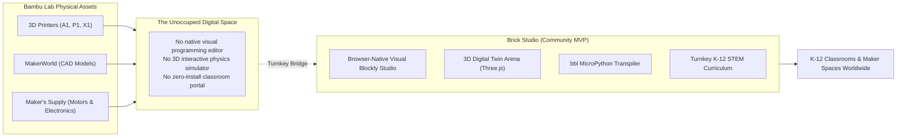

# An Open Proposal to Bambu Lab
### Bridging 3D Printing, Maker's Supply, and Global K-12 Robotics Education with Brick Studio

---

**Type:** Open-Source Community Initiative & Strategic Partnership Proposal  
**Presented By:** Independent Developer, Educator & Robotics Community  
**Target Recipient:** Bambu Lab Leadership, MakerWorld Product Team, Maker's Supply Hardware Group  
**Project Repository:** [Brick Studio on GitHub](https://github.com/bambulab-community/brick-studio)  
**Date:** October 2026

---

> **Legal Disclaimer:** Brick Studio is an independent, community-driven open-source project. It is not an official product of, nor is it currently affiliated with, sponsored by, or endorsed by Bambu Lab (Shenzhen Tuozhu Technology Co., Ltd.). Bambu Lab, MakerWorld, Bambu Studio, and Maker's Supply are trademarks of Bambu Lab.

---

## 1. Executive Summary

Bambu Lab has transformed desktop manufacturing with unprecedented print speed, multi-material capabilities, and the vibrant MakerWorld community. Furthermore, the launch of **Maker's Supply** demonstrated Bambu Lab's ambition to expand beyond static decorative models into functional mechanical assemblies, motors, and electronics.

However, in the global educational robotics market ($4.2 billion), **hardware alone is not enough**.

Competitors like **LEGO Education Spike Prime** ($450+) and **VEX IQ** ($400+) dominate elementary, middle, and high school STEM programs because they offer a tightly integrated, branded software playground alongside their physical parts.

**Brick Studio** was created by our community to demonstrate how Bambu Lab can effortlessly capture this educational market without spending millions on proprietary software development:
- An instant, browser-based visual programming environment (Google Blockly) requiring **zero installation** on school Chromebooks and iPads.
- A high-fidelity 3D digital twin simulator (Three.js) that renders printable MakerWorld vehicles (`BrickForklift`, `BrickTruck`), differential kinematics, ultrasonic raycasting, and active mechanisms.
- A direct transpiler that turns visual blocks into standard MicroPython code for the ESP32-C3 CyberBrick board.
- A complete, turnkey 6-lesson STEM curriculum ready for classroom adoption.

---

## 2. Why We Built This: The Missing Software Link

### The Inherent Problem with Competing Robotics Kits
- **LEGO Spike Prime:** Extremely expensive ($400-$550 per kit), non-printable proprietary plastic parts, expensive replacement components, closed ecosystem.
- **VEX Robotics:** High cost, complex proprietary snap pins, closed electronics.
- **The Bambu Lab Alternative:** A classroom with a single $199 Bambu Lab A1 mini and Maker's Supply hardware components ($25-$40 per student kit) can print unlimited chassis replacements, customize wheel sizes, iterate on mechanical linkages, and learn real-world engineering at 10% of traditional costs.

**Brick Studio provides the free, open software engine that makes this vision tangible today.**

---

## 3. Potential Collaboration & Adoption Models

We are submitting this working MVP openly to Bambu Lab. We would be thrilled to explore any of the following collaboration pathways:

### Model A: Official Ecosystem Integration (Recommended)
- **MakerWorld Integration:** Add a native **[Open & Program in Brick Studio]** button to compatible robotics models on MakerWorld.
- **Hosted Subdomain:** Bambu Lab hosts the open-source client-side code under an official domain (e.g. `studio.bambulab.com` or `robotics.makerworld.com`).
- **Official Hardware Bundle:** Maker's Supply offers a boxed **"Maker's Supply Robotics STEAM Starter Kit"** containing the ESP32-C3 board, N20 motors, servos, sensors, and a quick-start card directing students to the web studio.

### Model B: Verified Community Ecosystem Project
- Bambu Lab recognizes Brick Studio as a featured community project on MakerWorld and the Bambu Community Forum.
- Joint community design challenges on MakerWorld (e.g., "Design an Articulated Attachment for BrickForklift").
- Collaborative verification of MicroPython firmware standards across new Maker's Supply electronic releases.

### Model C: Open-Source Stewardship
- The project remains independent under the permissive MIT license, with Bambu Lab engineers participating as open-source contributors and technical advisors.

---

## 4. Technical Architecture: Zero Operational Cost for Bambu Lab

One of the greatest strengths of Brick Studio is that it was intentionally engineered with **zero cloud operating overhead**:
- **100% Client-Side Execution:** The 3D Three.js physics solver, Blockly AST parser, and MicroPython generator run entirely in the user's browser.
- **Zero Cloud Server Costs:** Hosting the application costs virtually zero on standard CDNs (GitHub Pages, Cloudflare, or AWS S3).
- **Privacy & Compliance (GDPR, FERPA, COPPA):** Because no student accounts, passwords, or personal data are stored on remote servers, school districts can adopt Brick Studio immediately without lengthy administrative or security audits.

---

## 5. Proposed Next Steps for the Bambu Lab Team

If you are a member of the Bambu Lab engineering, MakerWorld, or business development teams:
1. **Test the Live Simulator:** Open `index.html` in your browser. Drive the `BrickForklift`, test the ultrasonic radar, pick up a pallet, and click **Python** to inspect the clean `bbl` code.
2. **Review the Curriculum:** Read through the 6 comprehensive modules in [`docs/curriculum/INDEX.md`](curriculum/INDEX.md).
3. **Contact the Maintainers:** Open a GitHub Discussion or Issue in this repository, or reach out to explore how we can collaborate to empower the next generation of engineers.
