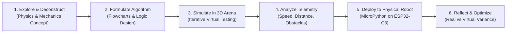

# Brick Studio: K-12 STEAM Robotics Curriculum
### An Independent Standards-Aligned Educational Program for Bambu Lab Maker's Supply & MakerWorld

---

> **Notice:** This curriculum is an independent educational resource created for the Bambu Lab maker and robotics community. It is not an official Bambu Lab curriculum. Bambu Lab, MakerWorld, and Maker's Supply are trademarks of Bambu Lab.

---

## Curriculum Overview

The **Brick Studio STEAM Robotics Curriculum** is a six-lesson, project-based educational syllabus designed for middle school and high school classrooms (Grades 6-12), robotics clubs, summer camps, and maker workshops.

By fusing **digital twin 3D simulation**, **visual block programming**, **mathematical kinematics**, and **physical computing on Bambu Lab printable hardware**, students transition seamlessly from software algorithms to real-world mechanical and electrical systems.

```text
Level 1: Foundations (Lessons 1 & 2)
├── Lesson 1: Introduction to Robotics & CyberBrick Hardware Anatomy
└── Lesson 2: Differential Drive Kinematics & Precision Trajectory Control

Level 2: Applied Actuation & Sensing (Lessons 3 & 4)
├── Lesson 3: Industrial Servo Mechanics & Automated Warehouse Pallet Handling
└── Lesson 4: Ultrasonic Radar & Closed-Loop Collision Avoidance

Level 3: Autonomy & Physical Realization (Lessons 5 & 6)
├── Lesson 5: Automated Guided Vehicles (AGV) & Optical Line Following
└── Lesson 6: The Digital Twin Capstone: 3D Printing, Slicing & Hardware Deployment
```

---

## Pedagogical Methodology (The "Sim-to-Real" Cycle)

Every lesson follows the proven **Sim-to-Real Engineering Cycle**:



---

## Detailed Lesson Directory

| Module | Lesson Title | Key Concepts | Virtual Environment | MicroPython Firmware Modules |
| :---: | :--- | :--- | :--- | :--- |
| **01** | [Getting Started & Hardware Anatomy](LESSON_01_INTRODUCTION_AND_HARDWARE.md) | Microcontrollers, PWM, digital output, electrical buses | Logistics Warehouse | `bbl.leds`, `bbl.buzzer` |
| **02** | [Kinematics & Precision Motion](LESSON_02_KINEMATICS_AND_MOTION.md) | Differential drive, linear velocity, angular velocity ($\omega$), odometry | Logistics Warehouse | `bbl.motors`, `time` |
| **03** | [Servo Mechanics & Stacking](LESSON_03_FORKLIFT_MECHANISMS_AUTOMATION.md) | Mast linkages, torque, center of gravity, cargo latching | Logistics Warehouse | `bbl.servos`, `bbl.motors` |
| **04** | [Ultrasonic Sensing & Collision Avoidance](LESSON_04_ULTRASONIC_OBSTACLE_AVOIDANCE.md) | Time-of-flight, speed of sound, conditional logic, emergency brakes | Sandbox Playground | `ultrasonic`, `bbl.motors` |
| **05** | [Optical Line Tracking & AGV Systems](LESSON_05_LINE_TRACKING_AGV.md) | Infrared reflectance, state machines, closed-loop feedback | F1 & AGV Line Track | `line_sensor`, `bbl.motors` |
| **06** | [The Sim-to-Real Capstone](LESSON_06_FROM_SIMULATION_TO_HARDWARE.md) | Bambu Studio slicing, tolerances, mechanical assembly, USB flashing | Full Lab & Field Arena | Complete System Integration |

---

## Educational Standards Alignment Matrix

| Standard Code | Standard Title | Addressed in Lessons |
| :--- | :--- | :---: |
| **CSTA 1B-AP-10** | Create programs with sequences, events, loops, and conditionals | Lessons 1, 2, 3, 4, 5 |
| **CSTA 2-AP-13** | Decompose problems and subproblems into reusable algorithms | Lessons 3, 4, 5, 6 |
| **CSTA 3A-CS-01** | Explain how abstractions hide underlying hardware implementation details | Lessons 1, 6 |
| **ISTE 1.4** | Innovative Designer: Employ deliberate design and iterative testing | Lessons 2, 3, 6 |
| **ISTE 1.5** | Computational Thinker: Develop and employ problem-solving strategies | Lessons 2, 4, 5 |
| **NGSS MS-ETS1-2**| Evaluate competing design solutions using a systematic process | Lessons 3, 6 |
| **NGSS MS-ETS1-4**| Develop models to generate data for iterative testing and modification | Lessons 2, 4, 5, 6 |

---

## Classroom Implementation Guide

### Prerequisites
- **Student Background:** Basic computer literacy (mouse/touch operation). No prior coding experience required.
- **Hardware Requirements:** Any device capable of running a modern web browser (Google Chrome, Microsoft Edge, Safari, Firefox). Chromebooks, laptops, desktops, or tablets.
- **Physical Robotics Equipment (Optional for Lessons 1-5, Required for Lesson 6):** 1x Bambu Lab 3D printer (A1 mini or higher) per classroom, 1x Maker's Supply CyberBrick Robotics Kit per 2-3 students.

### Recommended Time Allocation
- **Standard Schedule:** 6 weeks (1 lesson per week, 60-90 minutes per session).
- **Intensive Workshop:** 2-day boot camp (3 lessons per day, 4 hours per day).
