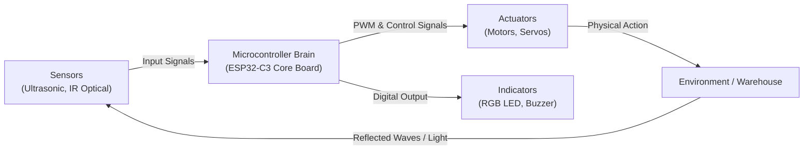

# Lesson 01: Introduction to Robotics & Hardware Anatomy
### Module 1: Foundations of Physical Computing with the Bambu CyberBrick Architecture

---

- **Grade Level:** 6 - 12 (Middle & High School)
- **Duration:** 60 - 90 Minutes
- **Prerequisites:** None (Beginner friendly)
- **Primary Tool:** Brick Studio (Web Browser)
- **Target Hardware:** Bambu CyberBrick Core Board (ESP32-C3 RISC-V)

---

## 1. Learning Objectives

By the end of this lesson, students will be able to:
1. Identify the core components of an autonomous robotic vehicle (Controller, Actuators, Sensors, Power Supply).
2. Explain the role of a microcontroller (MCU) as the "brain" that executes sequences of instructions.
3. Understand binary and multi-state digital outputs by controlling an RGB status beacon and an acoustic buzzer.
4. Construct, test, and debug their first visual block program in the Brick Studio 3D digital twin simulator.
5. Inspect the generated MicroPython code and explain how high-level visual blocks map to hardware registers.

---

## 2. Theory & Core Concepts

### A. What Makes a Robot?
A robot is not just a computer, and not just a motorized machine. A robot is an integrated system that connects three fundamental domains:
- **Sensing:** Gathering data from the physical world (distance, light, line reflection).
- **Thinking (Processing):** Executing logical instructions based on program sequences and sensory feedback.
- **Acting:** Modifying the physical environment through mechanical motion, light, or sound.



### B. The CyberBrick Core Board (ESP32-C3)
At the heart of the Bambu Lab robotic ecosystem is the **CyberBrick Core Board (XA003)**:
- **Processor:** 32-bit RISC-V single-core processor running at 160 MHz.
- **Power Delivery:** High-efficiency buck regulator accepting 7.4V from dual Li-ion cells and regulating clean 5V and 3.3V rails for sensitive sensors and logic.
- **Dual H-Bridge Motor Drivers:** Converts low-power logic pulses from the microcontroller into high-current power to spin DC gearmotors forwards or backwards.
- **Onboard Indicators:** A programmable 24-bit RGB LED (WS2812B) and an active acoustic piezo buzzer.

---

## 3. Hands-On Simulation Activity: The Safety Beacon

In industrial warehouses, autonomous automated vehicles must never start moving without first issuing visual and audible safety warnings to human operators.

### Student Mission
Program your `BrickForklift` to perform an industrial startup sequence:
1. Initialize the RGB status beacon to Solid Yellow (Warning: System Booting).
2. Sound two short horn beeps (120 ms each) with a 200 ms pause in between.
3. Transition the status beacon to Solid Green (Ready for Operation).
4. Output a system log to the serial console stating: `"BrickForklift Unit #01 Online"`.

### Step-by-Step Block Construction

1. Open **Brick Studio** in your web browser. Ensure the model is set to `BrickForklift`.
2. Navigate to the **Isik ve Korna (Lights & Horn)** category in the left toolbox:
   - Drag out a `cb_set_rgb` block. Set the dropdown to **Sari (Dikkat) / Yellow (Warning)**.
   - Attach a `cb_horn_beep` block below it. Set duration to `120` ms.
3. Open the **Zaman ve Donguler (Timing & Loops)** category:
   - Drag a `cb_wait_ms` block and connect it below the horn block. Set the wait time to `200` ms.
4. Add the second horn beep:
   - Attach another `cb_horn_beep` block (`120` ms).
5. Switch status beacon to ready:
   - Attach a second `cb_set_rgb` block and set it to **Yesil (Hazir) / Green (Ready)**.
6. Print confirmation:
   - Open **Seri Port (Log)** and attach a `cb_print_log` block with text: `"BrickForklift Unit #01 Online"`.

### Visual Block Architecture

```text
[Ayarla: RGB Isik -> Sari (245, 158, 11)]
    └── [Korna / Bip: 120 ms]
        └── [Bekle: 200 ms]
            └── [Korna / Bip: 120 ms]
                └── [Ayarla: RGB Isik -> Yesil (0, 174, 66)]
                    └── [Konsol Yaz: "BrickForklift Unit #01 Online"]
```

---

## 4. Running the Code & Analyzing Telemetry

1. Click the green **Calistir (Run)** button in the header toolbar.
2. Watch the 3D viewport:
   - The beacon atop the forklift cabin immediately illuminates yellow.
   - The virtual buzzer emits two audible safety tones via Web Audio.
   - The beacon switches to vibrant green.
3. Observe the Serial Monitor at the bottom:
   - Confirm that the message `BrickForklift Unit #01 Online` appears with an exact system timestamp.

---

## 5. MicroPython Code Inspection

Click the **Python** button in the editor toolbar. Observe the transpiled code:

```python
import time
from bbl.leds import LEDController
from bbl.buzzer import BuzzerController

leds = LEDController()
buzzer = BuzzerController()

# 1. Industrial Boot Sequence
leds.set_color(245, 158, 11)   # Yellow (Standby)
buzzer.beep(120)               # First horn pulse
time.sleep_ms(200)             # Inter-pulse delay
buzzer.beep(120)               # Second horn pulse
leds.set_color(0, 174, 66)     # Green (Operational)
print("BrickForklift Unit #01 Online")
```

### Key Engineering Observations
- `leds.set_color(R, G, B)` uses 8-bit color channels ($0 - 255$).
- `time.sleep_ms(ms)` pauses execution cleanly without locking the microcontroller's hardware timers.

---

## 6. Challenge & Extension Tasks

- **Level 1 Challenge:** Modify the sequence so the beacon flashes Red three times quickly before turning green (simulating an emergency diagnostic self-test).
- **Level 2 Challenge:** Combine color and audio cues to create a "reverse backup beeper" alarm (Yellow light pulsing in unison with 300 ms horn beeps).

---

## 7. Assessment & Review Questions

1. Why do autonomous warehouse robots need both visual (LED) and auditory (buzzer) signaling methods?
2. What happens if a programmer forgets to put a `cb_wait_ms` block between two `cb_horn_beep` commands?
3. In physical computing, what is the role of an H-bridge motor driver, and why can't a microcontroller pin power a DC motor directly?
