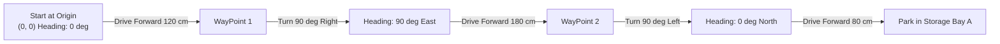

# Lesson 02: Kinematics & Precision Motion Control
### Module 2: Differential Drive Mathematics, Trajectory Calculation & Arena Navigation

---

- **Grade Level:** 6 - 12 (Middle & High School)
- **Duration:** 60 - 90 Minutes
- **Prerequisites:** Lesson 01
- **Primary Tool:** Brick Studio (Web Browser)
- **Mathematical Concepts:** Ratios, Linear Velocity ($v$), Angular Velocity ($\omega$), Circumference, Radians, Coordinate Systems

---

## 1. Learning Objectives

By the end of this lesson, students will be able to:
1. Explain how a differential drive robot changes direction using independent wheel speeds.
2. Apply the mathematical equations relating linear velocity, angular velocity, and time to calculate exact travel distances.
3. Calculate the duration ($t$) required to rotate a vehicle by an exact angle ($\theta$) given its track width ($W$).
4. Program precise rectilinear and rotational maneuvers in the Brick Studio 3D Warehouse arena.
5. Contrast open-loop time-based driving with calibrated odometry control.

---

## 2. Theory & Mathematical Foundations

### A. The Differential Drive Configuration
Most mobile robots and industrial warehouse AGVs utilize a **differential drive** kinematic layout:
- Two independent drive wheels sharing a common axis with track width (wheelbase) $W$.
- One or two passive free-swiveling caster wheels for balance.

```text
               Front of Robot
               ▲
               │
        [Left Wheel] ──── Track Width W ──── [Right Wheel]
          Velocity v_L                         Velocity v_R
               │
               ▼
```

### B. Kinematic Equations
When the left motor spins at velocity $v_L$ and the right motor at $v_R$:

1. **Forward Linear Velocity ($v$):**
   $$v = \frac{v_L + v_R}{2}$$
   - When both wheels turn at the same forward speed ($v_L = v_R = v_0$), the robot drives straight forward with speed $v_0$.
   - When both wheels turn at the same speed in opposite directions ($v_L = -v_R$), linear velocity is zero ($v = 0$), and the robot rotates in place about its geometric center.

2. **Rotational Angular Velocity ($\omega$ in radians per second):**
   $$\omega = \frac{v_R - v_L}{W}$$
   - If $v_R > v_L$, $\omega > 0$: The robot steers to the **Left**.
   - If $v_L > v_R$, $\omega < 0$: The robot steers to the **Right**.

3. **Turning Duration for Target Angle ($\theta$):**
   To turn the robot on its central axis by an angle $\theta$ (in radians), spinning wheels at $+v_0$ and $-v_0$:
   $$\omega_{\text{turn}} = \frac{2 \cdot v_0}{W}$$
   $$t_{\text{turn}} = \frac{\theta}{\omega_{\text{turn}}} = \frac{\theta \cdot W}{2 \cdot v_0}$$

---

## 3. Hands-On Simulation Activity: Warehouse Course Navigation

In this activity, students will program the `BrickForklift` to navigate out of the charging bay, execute an exact 90-degree right turn around an obstacle stack, and park accurately inside Storage Bay A.



### Mission Requirements
1. Drive forward **120 cm** at **50% speed**.
2. Stop motors cleanly for **300 ms** to eliminate vehicle inertia.
3. Turn **Right by exactly 90 degrees** at **55% speed**.
4. Drive forward **180 cm** past the storage pallets.
5. Turn **Left by exactly 90 degrees**.
6. Drive forward **80 cm** and sound the horn to signify completion.

---

## 4. Visual Block Implementation in Brick Studio

1. Ensure the arena is set to **Depo (Warehouse)**.
2. From the **Surus ve Hareket (Drive & Motion)** category:
   - Attach `cb_move_distance` with direction **Ileri (FORWARD)**, distance `120` cm, and speed `50`%.
   - Attach a `cb_stop_motors` block.
3. Add a stabilization pause:
   - From **Zaman ve Donguler**, attach `cb_wait_ms` with `300` ms.
4. Execute the first turn:
   - Attach a `cb_turn_angle` block with direction **Saga Don (RIGHT)**, angle `90` degrees, speed `55`%.
   - Attach a `cb_wait_ms` block (`200` ms).
5. Execute the long corridor drive:
   - Attach `cb_move_distance` (**Ileri**, distance `180` cm, speed `50`%).
   - Attach `cb_stop_motors`.
   - Attach `cb_wait_ms` (`300` ms).
6. Turn toward the bay:
   - Attach `cb_turn_angle` (**Sola Don (LEFT)**, angle `90` degrees, speed `55`%).
   - Attach `cb_wait_ms` (`200` ms).
7. Final approach and park:
   - Attach `cb_move_distance` (**Ileri**, distance `80` cm, speed `45`%).
   - Attach `cb_stop_motors`.
   - Attach `cb_horn_beep` (`250` ms).

---

## 5. MicroPython Code Analysis

Click the **Python** button to inspect the hardware-level translation:

```python
import time
from bbl.motors import MotorsController
from bbl.buzzer import BuzzerController

motors = MotorsController()
buzzer = BuzzerController()

# Function: Precise Distance Drive
def drive_distance_cm(dist_cm, speed_pct):
    pwm = int((speed_pct / 100) * 1024)
    # Velocity at 100% PWM is approx 3.0 m/s = 300 cm/s
    speed_cm_s = (speed_pct / 100) * 300
    duration_ms = int((dist_cm / speed_cm_s) * 1000)
    motors.set_speed(1, pwm)
    motors.set_speed(2, pwm)
    time.sleep_ms(duration_ms)
    motors.set_speed(1, 0)
    motors.set_speed(2, 0)

# Function: Precise In-Place Turn
def turn_degrees(angle_deg, speed_pct, turn_right=True):
    pwm = int((speed_pct / 100) * 1024)
    wheelbase = 1.1  # meters (scaled)
    linear_v = (speed_pct / 100) * 3.0
    omega = (2 * linear_v) / wheelbase
    rad = (angle_deg * 3.14159) / 180.0
    duration_ms = int((rad / omega) * 1000)
    
    dir_l = 1 if turn_right else -1
    dir_r = -1 if turn_right else 1
    motors.set_speed(1, dir_l * pwm)
    motors.set_speed(2, dir_r * pwm)
    time.sleep_ms(duration_ms)
    motors.set_speed(1, 0)
    motors.set_speed(2, 0)

# Execute Waypoints
drive_distance_cm(120, 50)
time.sleep_ms(300)
turn_degrees(90, 55, turn_right=True)
time.sleep_ms(200)
drive_distance_cm(180, 50)
time.sleep_ms(300)
turn_degrees(90, 55, turn_right=False)
time.sleep_ms(200)
drive_distance_cm(80, 45)
buzzer.beep(250)
```

---

## 6. Challenges & Engineering Optimization

- **Experiment 1 (Surface Friction & Slip):** In the physical world, wheels experience slip. If your physical robot turns only 84 degrees instead of 90 degrees on a carpeted floor, how would you introduce a correction factor $k_{\text{slip}}$ into the turning equation?
- **Experiment 2 (Smooth Ramp-Up):** Abrupt starts cause wheel spinning. Try inserting intermediate speed steps (e.g. 25% for 0.2s before 50%) to examine how smooth acceleration affects accuracy.

---

## 7. Review & Concept Checks

1. If you increase the robot's track width $W$, does it take more time or less time to turn 90 degrees at the same wheel speed? Explain using the formula.
2. In differential steering, what wheel command makes the robot pivot around its left wheel rather than turning on its central axis?
3. Why is a short wait delay (`time.sleep_ms(200)`) recommended between high-speed forward driving and an abrupt rotational turn?
