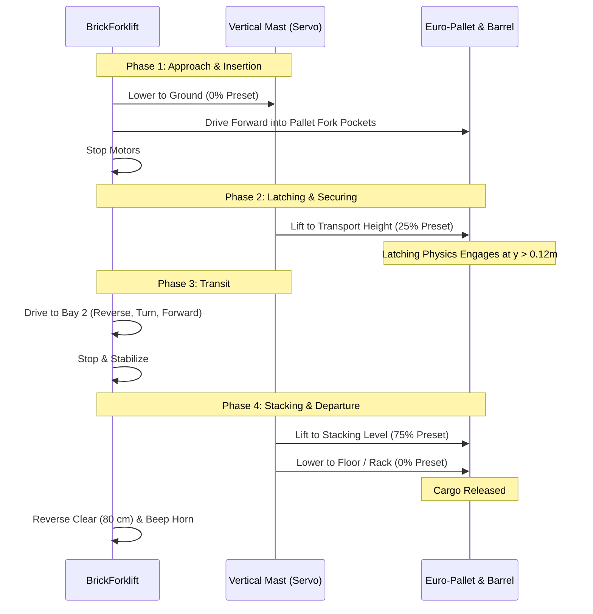

# Lesson 03: Industrial Servo Mechanisms & Automated Stacking
### Module 3: Actuator Types, Vertical Lift Linkages, Center of Gravity & Cargo Physics

---

- **Grade Level:** 6 - 12 (Middle & High School)
- **Duration:** 75 - 90 Minutes
- **Prerequisites:** Lessons 01 & 02
- **Primary Tool:** Brick Studio (Web Browser)
- **Mechanical Concepts:** Servomotors vs DC Motors, Rack & Pinion, Torque, Center of Mass (CoM), Tipping Moments, Automated Logistics

---

## 1. Learning Objectives

By the end of this lesson, students will be able to:
1. Differentiate between continuous rotation DC motors (traction) and closed-loop position servos (manipulators).
2. Understand the mechanical translation of rotary servo motion into vertical linear mast displacement.
3. Analyze the impact of elevated payload masses on a vehicle's center of gravity and tipping threshold.
4. Program a complete industrial pallet pickup, transport, and stacking sequence using the `BrickForklift`.
5. Implement safe transport standards (carrying cargo low at 25% height during transit to prevent rollover).

---

## 2. Theory & Mechanical Engineering Principles

### A. DC Motors vs. Servomotors
Autonomous vehicles utilize different actuator topologies depending on the physical task:

| Property | DC Traction Motor (Wheels) | RC Micro Servomotor (Mast / Arm) |
| :--- | :--- | :--- |
| **Motion Type** | Continuous $360^\circ$ rotation | Closed-loop angular positioning ($0^\circ - 180^\circ$) |
| **Control Signal** | PWM duty cycle (determines speed) | 50 Hz PWM pulse width ($1.0\text{ ms} - 2.0\text{ ms}$) |
| **Internal Feedback** | None (open loop) or external encoder | Internal potentiometer and closed-loop PID circuit |
| **Primary Function** | Propulsion and steering | Articulated linkages, cranes, steering racks, forks |

### B. Vertical Mast Elevator Mechanics
The 3D-printable `BrickForklift` converts rotational servo motion into vertical linear displacement ($y$):
- **Lower Limit ($0^\circ$ Servo / 0% Height):** Forks rest flush with the warehouse floor ($y = 0.06\text{ m}$), allowing the tapered blades to slide beneath Euro-pallets.
- **Transport Level ($45^\circ$ Servo / 25% Height):** Forks elevate the cargo 30 cm off the floor. This provides ground clearance over curbs while keeping the vehicle's **Center of Mass (CoM)** as low as possible.
- **High Stacking Level ($135^\circ$ Servo / 75% Height):** Forks elevate up to 0.95 m to clear shipping containers or warehouse staging racks.
- **Maximum Reach ($180^\circ$ Servo / 100% Height):** Maximum vertical extension ($1.25\text{ m}$).

```text
               Vertical Mast Assembly
               ┌──┐
               │  │  ◄── Maximum Height (100% / 1.25 m)
               │  │
               │  │  ◄── High Stacking Level (75% / 0.95 m)
               │  │
               │▓▓│  ◄── Transport Level (25% / 0.30 m) - Low Center of Mass
               └──┘
               ════  ◄── Floor / Insertion Level (0% / 0.06 m)
```

### C. Stability & Tipping Moments
When a forklift carries a heavy load high in the air, the combined Center of Mass shifts forward and upward. If the vehicle accelerates or brakes abruptly while the load is elevated, the inertial tipping moment ($M_{\text{tip}} = m \cdot a \cdot h$) can overcome the vehicle's counterweight wheelbase, causing it to flip forward.

**Golden Safety Rule of Automated Guided Vehicles (AGV):**  
*Never transport cargo with the mast elevated. Pick up, raise to 25% for transit, stop at the destination, raise to 75%, deposit, and lower.*

---

## 3. Hands-On Mission: The Automated Logistics Cycle

Students will program the `BrickForklift` to retrieve a loaded Euro-pallet from Bay 1, transport it across the warehouse, and stack it inside Bay 2.



---

## 4. Visual Block Implementation

1. **Phase 1: Approach and Alignment**
   - Attach `cb_forklift_preset` and set dropdown to **Zemine Indir (0%)**.
   - Attach `cb_move_distance` (**Ileri**, distance `110` cm, speed `45`%).
   - Attach `cb_stop_motors`.

2. **Phase 2: Engage and Lift Cargo**
   - Attach `cb_forklift_preset` and set dropdown to **Tasima Seviyesi (25%)**.
   - Attach `cb_wait_ms` (`500` ms) to allow the physical mechanism to elevate and latch.

3. **Phase 3: Safe Transportation**
   - Attach `cb_move_distance` (**Geri**, distance `100` cm, speed `45`%).
   - Attach `cb_turn_angle` (**Saga Don**, angle `90` degrees, speed `50`%).
   - Attach `cb_move_distance` (**Ileri**, distance `140` cm, speed `50`%).
   - Attach `cb_stop_motors`.
   - Attach `cb_wait_ms` (`300` ms).

4. **Phase 4: Deposit Cargo & Retreat**
   - Attach `cb_forklift_preset` and set dropdown to **Zemine Indir (0%)**.
   - Attach `cb_wait_ms` (`500` ms).
   - Attach `cb_move_distance` (**Geri**, distance `90` cm, speed `45`%).
   - Attach `cb_stop_motors`.
   - Attach `cb_horn_beep` (`250` ms).

---

## 5. MicroPython Code Translation

Inspect the generated MicroPython code:

```python
import time
from bbl.motors import MotorsController
from bbl.servos import ServosController
from bbl.buzzer import BuzzerController

motors = MotorsController()
servos = ServosController()
buzzer = BuzzerController()

def set_fork_preset(percent):
    # Convert 0-100% to 0-180 degree servo angle
    angle = int((percent / 100.0) * 180)
    servos.set_angle(1, angle)
    time.sleep_ms(450)  # Allow servo mechanical transit time

# 1. Approach Pallet
set_fork_preset(0)
# (Drive forward into pallet)
motors.set_speed(1, 460)
motors.set_speed(2, 460)
time.sleep_ms(1600)
motors.set_speed(1, 0)
motors.set_speed(2, 0)

# 2. Lift to Safe Transport Level
set_fork_preset(25)

# 3. Transport Maneuvers
# (Reverse out)
motors.set_speed(1, -460)
motors.set_speed(2, -460)
time.sleep_ms(1500)
motors.set_speed(1, 0)
motors.set_speed(2, 0)

# (Turn 90 degrees)
motors.set_speed(1, 512)
motors.set_speed(2, -512)
time.sleep_ms(580)
motors.set_speed(1, 0)
motors.set_speed(2, 0)

# 4. Deposit & Retreat
set_fork_preset(0)
motors.set_speed(1, -460)
motors.set_speed(2, -460)
time.sleep_ms(1200)
motors.set_speed(1, 0)
motors.set_speed(2, 0)
buzzer.beep(250)
```

---

## 6. Engineering Extension Challenge

- **Two-Tier Stacking Challenge:** In the Sandbox arena, place two Euro-pallets side-by-side. Program the forklift to pick up Pallet #1, lift it to Stacking Height (75%), drive forward slowly, and gently set it directly on top of Pallet #2 without knocking over the top barrel!

---

## 7. Review Questions

1. Why does an RC servo motor accept an angle command ($0^\circ - 180^\circ$) while a DC motor accepts a speed command (PWM)?
2. In terms of center of mass ($CoM$), why is driving with cargo raised to 100% height dangerous on a slope or during a fast turn?
3. How does the 3D simulation determine that a pallet has been successfully picked up by the forklift forks?
