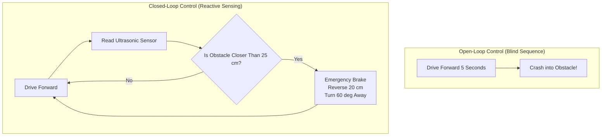

# Lesson 04: Ultrasonic Radar & Collision Avoidance
### Module 4: Time-of-Flight Sensing, Closed-Loop Control, and Autonomous Obstacle Avoidance

---

- **Grade Level:** 6 - 12 (Middle & High School)
- **Duration:** 75 - 90 Minutes
- **Prerequisites:** Lessons 01 - 03
- **Primary Tool:** Brick Studio (Web Browser)
- **Scientific & Computational Concepts:** Acoustic Time-of-Flight (ToF), Speed of Sound, Closed-Loop Feedback Control, Conditional Branching (`if-then-else`), Continuous Loops

---

## 1. Learning Objectives

By the end of this lesson, students will be able to:
1. Explain the physics of ultrasonic distance measurement using sound wave echo reflection.
2. Calculate physical distance using the acoustic time-of-flight equation ($d = \frac{v \cdot t}{2}$).
3. Differentiate between open-loop sequence execution and closed-loop reactive sensor control.
4. Program a reactive obstacle avoidance algorithm using conditional logic blocks (`if / else`) inside an infinite polling loop.
5. Implement safe emergency braking thresholds in the 3D Sandbox arena.

---

## 2. Theory & Physics of Ultrasonic Sensing

### A. How Ultrasonic Sensors Work
The ultrasonic sensor module on the front bumper of the robot (such as the standard HC-SR04 or RCWL-1601) consists of two acoustic transducers:
1. **Transmitter (Trigger):** Emits a burst of high-frequency ultrasonic sound waves (40 kHz, inaudible to human ears).
2. **Receiver (Echo):** Listens for the reflected sound wave bouncing off an object in front of the vehicle.

```text
               Robot Front
               ┌──────────┐
               │ [T]  [R] │
               └─┬──────▲─┘
                 │      │
      Trigger 40kHz     Reflected Echo
                 │      │
                 ▼      │
               ┌──────────┐
               │ Obstacle │
               └──────────┘
```

### B. The Time-of-Flight Equation
Sound travels through dry air at approximately $20^\circ\text{C}$ at a constant speed:
$$v_{\text{sound}} \approx 343\text{ m/s} = 0.0343\text{ cm/\mu s}$$

Because the sound pulse travels from the transmitter to the obstacle **and then back** to the receiver, the total distance traveled by the sound wave is twice the distance to the obstacle ($2d$):
$$2d = v_{\text{sound}} \cdot t_{\text{echo}}$$
$$d = \frac{v_{\text{sound}} \cdot t_{\text{echo}}}{2} = \frac{t_{\text{echo}}\text{ (in }\mu\text{s)}}{58.2}$$

In Brick Studio's 3D engine, this physical phenomenon is simulated in real time using **mathematical raycasting**, projecting a vector from the robot's front bumper forward into the Three.js physics world and computing the exact collision intersection distance in centimeters.

---

## 3. Open-Loop vs. Closed-Loop Robotics



In open-loop control, the robot executes commands blindly without knowing what is happening in its surroundings. In closed-loop control, the robot continually evaluates sensor feedback to alter its trajectory and protect itself from collisions.

---

## 4. Hands-On Activity: The Autonomous "Roomba" Wanderer

Students will build an autonomous reactive navigation algorithm for the `BrickTruck` or `BrickForklift` in the Sandbox arena.

### Algorithmic Logic
Inside an infinite loop:
1. Read the ultrasonic distance sensor.
2. If `Distance < 28 cm` (Obstacle detected):
   - Immediately stop motors (`cb_stop_motors`).
   - Switch RGB LED to Red.
   - Sound a short warning beep (`100 ms`).
   - Reverse 25 cm at 45% speed.
   - Turn Right 65 degrees at 50% speed.
3. Else (`Distance >= 28 cm`, Path is clear):
   - Set RGB LED to Green.
   - Cruise forward at 50% speed.

---

## 5. Visual Block Implementation

1. Open **Brick Studio** and select the **Serbest Alan (Sandbox)** arena.
2. From **Zaman ve Donguler**, drag out a `cb_loop_forever` (Sonsuz Dongu) block into the workspace.
3. Inside the `cb_loop_forever` container:
   - Drag an `if / else` block (click the mutator gear icon to add an `else` branch, or use the standard `controls_if` with `else`).
4. Set the condition:
   - From **Sensorler**, drag `cb_is_obstacle` into the `IF` socket. Set threshold to `28` cm.
5. In the `DO` (Obstacle detected) branch:
   - `cb_stop_motors`
   - `cb_set_rgb` -> **Kirmizi (Engel)**
   - `cb_horn_beep` -> `100` ms
   - `cb_move_distance` -> **Geri**, distance `25` cm, speed `45`%
   - `cb_turn_angle` -> **Saga Don**, angle `65` degrees, speed `50`%
6. In the `ELSE` (Path clear) branch:
   - `cb_set_rgb` -> **Yesil (Hazir)**
   - `cb_move_direction` -> **Ileri Sur**, speed `50`%
   - `cb_wait_ms` -> `50` ms (short polling delay)

---

## 6. MicroPython Code Translation

Click **Python** to inspect the clean MicroPython loop:

```python
import time
from bbl.motors import MotorsController
from bbl.leds import LEDController
from bbl.buzzer import BuzzerController

motors = MotorsController()
leds = LEDController()
buzzer = BuzzerController()

class UltrasonicSensor:
    def read_distance(self):
        # Simulated hardware call to Trigger/Echo pins
        return 45.0

ultrasonic = UltrasonicSensor()

print("[Brick Studio] Autonomous Obstacle Avoidance Online.")

while True:
    # Read current distance in centimeters
    distance_cm = ultrasonic.read_distance()
    
    if distance_cm < 28:
        # 1. Emergency Brake
        motors.set_speed(1, 0)
        motors.set_speed(2, 0)
        leds.set_color(255, 0, 0)  # Red alert
        buzzer.beep(100)
        
        # 2. Reverse Maneuver
        motors.set_speed(1, -450)
        motors.set_speed(2, -450)
        time.sleep_ms(600)
        
        # 3. Pivot Turn Away
        motors.set_speed(1, 500)
        motors.set_speed(2, -500)
        time.sleep_ms(450)
        
        motors.set_speed(1, 0)
        motors.set_speed(2, 0)
    else:
        # Cruising mode
        leds.set_color(0, 174, 66)  # Green
        motors.set_speed(1, 512)
        motors.set_speed(2, 512)
    
    # 25ms sampling interval
    time.sleep_ms(25)
```

---

## 7. Challenge & Optimization Tasks

- **Dead-End Escape Algorithm:** What happens if the robot gets trapped in a narrow corner between two shipping containers? Program a "stuck detector" counter: If the robot triggers 3 obstacles in less than 4 seconds, execute a full 180-degree turnaround!
- **Dynamic Speed Modulation:** Instead of a binary stop/go, make the cruising speed proportional to distance: As an obstacle gets closer ($100\text{ cm} \rightarrow 30\text{ cm}$), gradually reduce vehicle speed from 80% to 20%.

---

## 8. Review Questions

1. Why does an ultrasonic sensor struggle to detect sound-absorbing soft materials (such as foam or thick fabric) or surfaces angled at sharp $45^\circ$ angles?
2. If the speed of sound is $343\text{ m/s}$, how many microseconds ($\mu\text{s}$) does it take for an echo to return from an obstacle located $50\text{ cm}$ away?
3. What is the danger of setting the emergency braking distance threshold too small (e.g. 5 cm) on a heavy or fast-moving physical vehicle?
