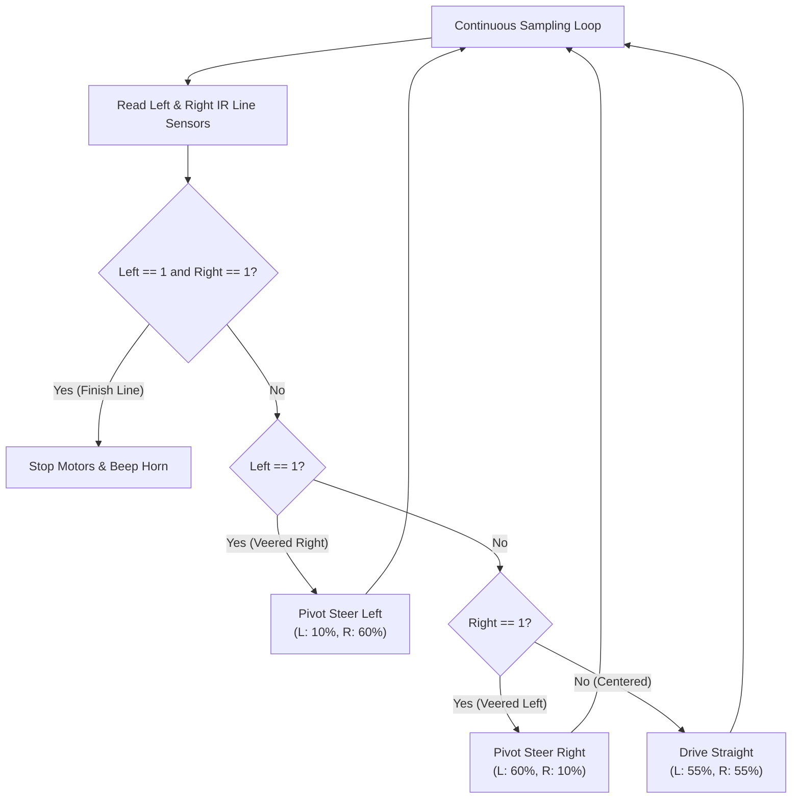

# Lesson 05: Optical Line Tracking & Industrial AGV Systems
### Module 5: Infrared Reflectance Sensors, State Machines, and Closed-Loop Feedback Control

---

- **Grade Level:** 6 - 12 (Middle & High School)
- **Duration:** 75 - 90 Minutes
- **Prerequisites:** Lessons 01 - 04
- **Primary Tool:** Brick Studio (Web Browser)
- **Scientific & Engineering Concepts:** Infrared Optoelectronics, Surface Albedo & Reflectance, Truth Tables & State Machines, Closed-Loop Feedback Control, Industrial AGV (Automated Guided Vehicles)

---

## 1. Learning Objectives

By the end of this lesson, students will be able to:
1. Explain how infrared (IR) optical reflectance sensors distinguish between high-albedo (white) and low-albedo (black) surfaces.
2. Formulate an 4-state logic truth table for a dual-sensor line tracking differential robot.
3. Construct a closed-loop reactive steering algorithm in Brick Studio's **F1 & AGV Line Track** arena.
4. Compare Bang-Bang steering control with differential tank speed trim (`moveTank`).
5. Successfully navigate an autonomous AGV through continuous curves, straightaways, and intersection stops.

---

## 2. Theory & Optoelectronic Sensor Physics

### A. How Optical Infrared Sensors Detect Lines
Modern smart factories (such as Amazon robotic fulfillment centers and automotive assembly plants) guide automated vehicles using floor-mounted magnetic or high-contrast optical tape.

The sensor module mounted beneath the front bumper of the robot (such as the TCRT5000) features two optical pairs:
- **Infrared Emitter LED:** Emits an invisible beam of infrared light (approx. 940 nm wavelength) toward the floor.
- **Phototransistor Receiver:** Measures the quantity of reflected infrared light bouncing back off the ground.

```text
       White Floor Tile                     Black Line Marker
       (High Reflectance / Albedo)          (Light Absorption)
          ▼             ▲                      ▼             ░
       Emitter       Receiver               Emitter       Receiver
          │             │                      │             ░
      [IR LED]    [Photodiode]             [IR LED]    [Photodiode]
          │             │                      │             ░
     ─────┴─────────────┴─────            ─────┴─────────────┴─────
     High Reflected Signal: 0              Zero Reflected Signal: 1
```

- **White / Light Surface:** Reflects the majority of the infrared photons back into the phototransistor, triggering a digital **LOW (0)**.
- **Black Surface:** Absorbs the infrared light; minimal photons return, triggering a digital **HIGH (1)**.

---

## 3. The 4-State Differential Steering Truth Table

When two sensors (**Left** and **Right**) straddle a black tracking line:

```text
          [Left Sensor]    (Black Track Line)    [Right Sensor]
               ○                  ▓▓▓▓▓                 ○
```

| State | Left Sensor | Right Sensor | Physical Robot Situation | Desired Vehicle Action | Left Motor | Right Motor |
| :---: | :---: | :---: | :--- | :--- | :---: | :---: |
| **00** | 0 (White) | 0 (White) | Perfectly Centered over track | Drive Straight Forward | +50% | +50% |
| **10** | 1 (Black) | 0 (White) | Drifting Right (Left sensor on line)| Steer Sharp Left | -10% | +55% |
| **01** | 0 (White) | 1 (Black) | Drifting Left (Right sensor on line)| Steer Sharp Right | +55% | -10% |
| **11** | 1 (Black) | 1 (Black) | Crossway / Finish Line Encountered | Stop Vehicle / Station Hold | 0% | 0% |

---

## 4. Hands-On Activity: The Autonomous AGV Lap Challenge

Students will program the `BrickTruck` or `BrickForklift` to autonomously complete a full lap of the F1 & AGV Line Track arena and stop cleanly at the Start/Finish gantry.



---

## 5. Visual Block Implementation

1. Open **Brick Studio** and select the **Cizgi Pisti (Line Track)** arena.
2. In the workspace, place a `cb_loop_forever` (Sonsuz Dongu) container.
3. Inside the loop, build a nested condition using `controls_if`:
   - **Condition 1 (Drifted Right):** If `cb_get_line (Sol Sensor)` is true:
     - Drag `cb_move_tank` from **Surus ve Hareket**: Set `Sol Motor = 0%`, `Sag Motor = 55%`.
   - **Condition 2 (Drifted Left):** Else if `cb_get_line (Sag Sensor)` is true:
     - Drag `cb_move_tank`: Set `Sol Motor = 55%`, `Sag Motor = 0%`.
   - **Condition 3 (Centered):** Else:
     - Drag `cb_move_tank`: Set `Sol Motor = 50%`, `Sag Motor = 50%`.
4. Add a high-frequency polling delay at the bottom of the loop:
   - `cb_wait_ms` with `20` ms.

---

## 6. MicroPython Code Translation

Click the **Python** button in the editor toolbar:

```python
import time
from bbl.motors import MotorsController
from bbl.leds import LEDController

motors = MotorsController()
leds = LEDController()

class LineSensor:
    def read_left(self):
        # Reads GPIO 6 (1 if on black tape, 0 if white)
        return 0
    def read_right(self):
        # Reads GPIO 7 (1 if on black tape, 0 if white)
        return 0

line_sensor = LineSensor()
leds.set_color(0, 180, 216)  # Blue (AGV Active Mode)
print("[Brick Studio] AGV Line Tracking Active.")

while True:
    left = line_sensor.read_left()
    right = line_sensor.read_right()
    
    if left == 1 and right == 0:
        # Correct left: Slow down left motor, drive right motor
        motors.set_speed(1, 0)
        motors.set_speed(2, 560)
    elif right == 1 and left == 0:
        # Correct right: Drive left motor, slow down right motor
        motors.set_speed(1, 560)
        motors.set_speed(2, 0)
    elif left == 1 and right == 1:
        # Cross-line or station stop
        motors.set_speed(1, 0)
        motors.set_speed(2, 0)
        print("[AGV] Station Stop Detected.")
        break
    else:
        # On-track centered cruising
        motors.set_speed(1, 512)
        motors.set_speed(2, 512)
        
    time.sleep_ms(20)
```

---

## 7. Advanced Engineering Optimization: Eliminating Oscillation

In simple "Bang-Bang" steering (switching a motor completely off or full-on), the robot visibly wiggles or fish-tails from side to side along the tape.

To achieve smooth, high-speed industrial AGV tracking:
- **Proportional Speed Trimming:** Instead of setting the inside motor to 0%, reduce it smoothly to 25% or 30%:
  ```text
  Turn Left:  Left Wheel = 30%, Right Wheel = 60%
  Turn Right: Left Wheel = 60%, Right Wheel = 30%
  Straight:   Left Wheel = 60%, Right Wheel = 60%
  ```
- Compare the lap times: Does proportional trimming allow the robot to finish the lap faster without derailing on sharp bends?

---

## 8. Review Questions

1. Why does an optical line follower work reliably on high-contrast matte tape, but may fail on glossy metallic surfaces under direct sunlight?
2. What would happen to the robot if the electrical wiring for the Left and Right optical sensors was accidentally swapped on the microcontroller pins?
3. In smart logistics warehouses, how can cross-lines (`Left = 1 and Right = 1`) be used to count warehouse aisle numbers automatically?
