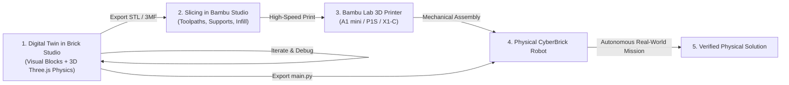

# Lesson 06: The Sim-to-Real Capstone
### Module 6: 3D Printing, Slicing in Bambu Studio, Physical Assembly, and MicroPython Deployment

---

- **Grade Level:** 8 - 12 (Advanced Middle & High School)
- **Duration:** 90 - 120 Minutes (Plus 3D print time)
- **Prerequisites:** Lessons 01 - 05
- **Primary Tools:** Brick Studio, Bambu Studio Slicer, Bambu Lab 3D Printer (A1/P1/X1)
- **Engineering Principles:** Digital Twin Paradigm, FDM Additive Manufacturing, Slicing Parameters & Mechanical Tolerances, Embedded Firmware Flashing

---

## 1. Learning Objectives

By the end of this capstone lesson, students will be able to:
1. Explain the **Digital Twin** concept used by modern aerospace, automotive, and smart manufacturing corporations.
2. Configure optimal mechanical slicing parameters in **Bambu Studio** for load-bearing robotics assemblies (wall loops, infill density, orientation).
3. Safely assemble the physical 3D-printed chassis, gearmotors, servomotor, battery, and CyberBrick Core Board.
4. Export their validated program from Brick Studio, flash `boot.py` and `main.py` onto the ESP32-C3 board via USB, and observe autonomous physical execution.
5. Identify and calibrate real-world discrepancies (friction, battery voltage sag, motor imbalance) using software tuning trims.

---

## 2. Theory: The Digital Twin Paradigm in Modern Industry

In leading engineering enterprises (including Bambu Lab, NASA, and Siemens), physical products are never manufactured blindly. Instead, engineers construct a **Digital Twin**:
1. **Virtual Modeling & Simulation:** The machine's physics, kinematics, and software algorithms are simulated in high-fidelity 3D software (just like Brick Studio).
2. **Stress & Logic Testing:** Edge cases, obstacle collisions, and control loops are debugged virtually where iterations take seconds and broken parts cost nothing.
3. **Additive Manufacturing Realization:** Once the digital twin performs flawlessly, mechanical parts are 3D-printed on-demand, electronic hardware is snapped in, and the exact same control code is deployed to the physical hardware.



---

## 3. Slicing the Robot in Bambu Studio

### A. Print Orientation Matters
When 3D printing functional robotics parts using Fused Deposition Modeling (FDM), parts are weakest along the Z-axis (between layers):
- **Chassis Baseplate:** Always print flat on the build plate. This aligns tensile forces parallel to the continuous filament strands.
- **Forklift Mast Rails:** Print standing vertically or with rails oriented along the bed diagonal.
- **Carriage Forks:** Print lying flat on their back spine to ensure the lifting prongs do not snap under load.

### B. Bambu Studio Slicing Checklist

| Slicing Parameter | Value | Engineering Rationale |
| :--- | :--- | :--- |
| **Layer Height** | `0.20 mm Standard` (or `0.16 mm Optimal`) | Balances dimensional accuracy of bearing holes with print speed |
| **Wall Loops** | `4 Walls` | Most structural strength in 3D prints comes from solid perimeter walls |
| **Top/Bottom Shells**| `4 Top, 4 Bottom` | Prevents pillowing and reinforces screw boss anchor points |
| **Infill Density** | `25%` | Provides rigidity without adding unnecessary weight |
| **Infill Pattern** | `Gyroid` | Isotropic strength in all three dimensions ($X, Y, Z$) |
| **Seam Position** | `Aligned` or `Back` | Keeps mechanical sliding channels clean and free of zits |
| **Brim Type** | `Auto Brim` (or `Outer Brim Only 5mm`) | Prevents warping on thin corner brackets |

---

## 4. Physical Mechanical & Electrical Assembly

Follow the step-by-step assembly sequence:

```text
Assembly Phase 1: Motors & Traction
1. Insert two N20 gearmotors into the lower chassis motor pockets.
2. Fasten the retaining brackets using M2 screws.
3. Press-fit the rubber TPU tires over the rims and push onto the 3mm D-shafts.

Assembly Phase 2: Forklift Elevator Mechanism
4. Slide the carriage fork assembly into the vertical mast guide channels.
5. Mount the 9g micro servo into the chassis mast base.
6. Connect the linkage arm between the servo horn and the carriage.
7. Calibrate the zero position: When the servo is at 0 degrees, forks must touch the ground.

Assembly Phase 3: Electronics & Power
8. Mount the CyberBrick Core Board into the top tray.
9. Connect Left Motor to M1 terminals and Right Motor to M2 terminals.
10. Plug the Elevator Servo into Channel 1.
11. Mount the ultrasonic sensor to the front grille and line sensors underneath.
12. Connect the 2S 7.4V battery pack. Verify the power switch is OFF.
```

---

## 5. Deploying MicroPython Firmware via USB

### Step 1: Export Code from Brick Studio
1. In Brick Studio, click the **Python** button in the editor toolbar.
2. In the modal, click **boot.py Indir** and **main.py Indir** to save both files to your computer.

### Step 2: Connect Board & Flash
1. Connect the CyberBrick Core Board to your computer using a USB-C data cable.
2. Open a standard MicroPython tool (such as **Thonny IDE** or the web-based Web Serial flasher):
   - Select port: `USB-Enhanced-SERIAL CH343` or `ESP32-C3 USB JTAG`.
   - Upload `boot.py` (hardware pin definitions) to the root directory `/`.
   - Upload `main.py` (your Brick Studio code) to the root directory `/`.
3. Disconnect USB, place your physical robot on the floor, and turn on the battery power switch!

---

## 6. Real-World Calibration (Sim-to-Real Tuning)

Because physical environments are never mathematically frictionless, students will observe slight variances between virtual simulation and real-world execution:

### 1. Straight-Line Drift (Motor Manufacturing Variance)
- **Symptom:** The robot drifts slightly to the right when both motors are commanded to 50%.
- **Cause:** Tiny differences in internal gear friction or coil windings between the two N20 motors.
- **Solution (Software Trim):**
  ```python
  # Apply a 4% trim correction to the faster motor:
  motors.set_speed(1, 512)       # Left motor (slightly weaker)
  motors.set_speed(2, int(512 * 0.96)) # Right motor trimmed
  ```

### 2. Turning Friction
- **Symptom:** The robot turns $82^\circ$ instead of $90^\circ$ on carpet.
- **Cause:** Carpet pile creates lateral scrub friction on the wheels.
- **Solution:** Increase the turning duration constant in the turn equation by multiplying by $1.08$ ($90 / 82 = 1.09$).

---

## 7. Capstone Project: The Automated Fulfillment Challenge

### The Grand Challenge
Replicate the entire logistics cycle in your physical classroom using your 3D-printed `BrickForklift`:
1. Start at the Charging Station.
2. Follow the black floor tape autonomously using the optical IR sensors.
3. Detect the 3D-printed wooden cargo pallet using the ultrasonic radar.
4. Stop 5 cm away from the pallet without bumping it.
5. Lower the forks, drive under the pallet, and elevate it to 25% transport height.
6. Reverse out, turn around, transport the pallet across the classroom track, and deposit it cleanly inside the designated Staging Bay!

---

## 8. Final Reflection & Portfolio Submission

Document your engineering journey in a project portfolio:
- Include screenshots of your Brick Studio block code and 3D simulation.
- Include photographs of your sliced models in Bambu Studio and your final assembled physical robot.
- Write a short engineering reflection: *What was the most challenging discrepancy between the virtual simulation and physical reality, and how did your team solve it through software or hardware tuning?*
